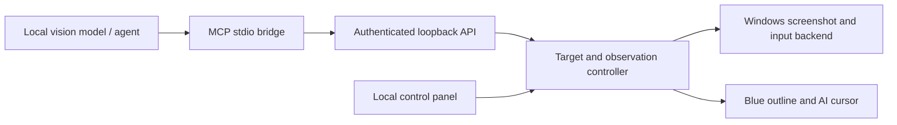

# Open Computer

An independent, MIT-licensed Windows computer-use toolkit for local and
open-source AI models. A desktop panel lets you choose a window and arm control;
the model observes screenshots and uses mouse and keyboard tools. A blue outline
and AI cursor make activity visible.

This is an early implementation, not a drop-in replacement for Codex's private
runtime. It follows the same **observe → one action → observe again** workflow.


## Install and run

Requires Windows, Python 3.11+ with Tkinter, and Pillow >=12.2,<13 for
[single-window capture](https://pillow.readthedocs.io/en/stable/reference/ImageGrab.html).
Native fixture validation used Pillow 12.2.0; clean installation also passed
with Pillow 12.3.0. Pillow 13 is excluded pending validation.

Download and extract this repository, then double-click **install.cmd**. After it
finishes, double-click **start-open-computer.cmd**. Python must already be
installed and available as `python`.

The same steps from PowerShell are:

```powershell
.\install.cmd
.\start-open-computer.cmd
```

The installer creates a project-local `.venv` in this folder, installs the package, and
writes two launchers. It does not start the app, arm control, or change a model
server. Double-click `start-open-computer.cmd` on later visits.

For a preview that simulates input, run `start-open-computer.cmd --demo`.
Ctrl+Alt+Esc is the emergency stop shortcut while the panel is running.

The local panel owns arming. Choose the intended window, arm it, and connect
your agent using the connection information in the panel. The API and MCP tools
cannot arm the computer. Disarm or Stop ends input authorization.

To upgrade, disarm and close the panel, update this source folder, and rerun the
installer. It updates the existing environment and regenerates the launchers.
Run this read-only check after starting the panel, keeping it disarmed:

```powershell
.\.venv\Scripts\python.exe -m opencomputer.setup doctor
```

Use `doctor --offline` to check dependencies without contacting a running panel.

## Components



- **Windows backend:** window discovery, screenshots, targeted mouse and keyboard
  operations through Win32.
- **Controller:** explicit target, local arming, fresh single-use observations,
  input validation, cancellation, and activity events.
- **Desktop panel:** target selection, status, activity feed, and stop controls.
- **Tool adapters:** authenticated localhost HTTP and an MCP stdio bridge.
- **Model adapter:** a bounded tool loop for an already-running OpenAI-compatible
  local vision model endpoint. No model downloads or model restarts.

Give your model the workflow in [docs/SKILL.md](docs/SKILL.md). Native coordinate
tools require a model that can interpret screenshots and call tools reliably.
The toolkit does not make a text-only model see.

## Connect an agent

Start the desktop panel first. Generate an MCP configuration that uses this
installation's absolute paths, including paths with spaces:

```powershell
.\.venv\Scripts\python.exe -m opencomputer.setup config
```

Import the resulting `mcpServers` JSON into your agent's MCP settings. For
Unsloth, use `config --format unsloth` and import the JSON into its MCP settings.
The generated configuration contains no service token. As a generic example,
an environment where `python` already has Open Computer installed can use:

```json
{
  "mcpServers": {
    "opencomputer": {
      "command": "python",
      "args": ["-m", "opencomputer.mcp"]
    }
  }
}
```

The bridge reads the local connection file at `~/.opencomputer/connection.json`.
Pass `--connection PATH` to use a different instance. Keep that file private;
it contains the service token.

Unsloth can import the same MCP server configuration. Registration, loading the
Open Computer skill, and a real read-only status call have been verified with
Unsloth; successful visual task
completion has not. Unsloth resizes images to a maximum edge of 1024 pixels while
the tool keeps the original dimensions. Follow the scaling instructions in
[docs/SKILL.md](docs/SKILL.md), or start with a target smaller than 1024 pixels on
each edge. Use a vision-capable model that supports tool calls.

For an already-running local vision model with OpenAI-compatible tool calling:

```powershell
.\.venv\Scripts\python.exe -m opencomputer.model_client "Describe the selected window" --model YOUR_MODEL --endpoint http://127.0.0.1:8080/v1 --max-steps 12
```

Replace the model name and endpoint with your server's actual configuration.
Select and arm the intended window locally before requesting input actions.
The runner does not load models, start model servers, or arm control. Model and
server compatibility must be tested for the specific setup you choose.

## Development

```powershell
.\.venv\Scripts\python.exe -m unittest discover -s tests -v
```

Tests with fake backends do not move the real mouse. The separately invoked native
smoke test uses an isolated fixture window. A Windows run has verified screenshot
capture, a typed test phrase, and its button counter after the user focused that
fixture. The model runner has been tested with deterministic model-response fixtures; successful
desktop task completion by a real vision model remains unverified.

```powershell
.\.venv\Scripts\python.exe scripts/native_smoke.py --run --wait-for-focus 60
```

Click the disposable test window when it appears. The test then types a known
phrase, clicks its button, verifies the results, and closes itself. Windows can
refuse background focus requests, so this explicit local focus step is needed
in some launch environments.

## Current boundaries

Windows only. Coordinates refer to the captured client area of the selected
window. Screenshot-based coordinate control comes first; accessibility
trees, DOM browser tools, occluded-window capture, and other operating systems
are future work. Windows input is shared with the user and is not an atomic
per-window transaction. Foreground, geometry, and occlusion checks reduce risk,
but do not establish a security sandbox. Use a separate desktop/VM for untrusted
agents, and avoid interacting with the target during an automated action.

The bearer token grants access to screen content and permitted tools; keep it
private. The service binds to loopback and rejects browser-origin requests.
Screenshots may contain private information: the agent and model endpoint you
choose receive those images.

See [CONTRIBUTING.md](CONTRIBUTING.md) for development and
[SECURITY.md](SECURITY.md) for private vulnerability reporting.

## License

[MIT](LICENSE). Built independently; no proprietary Codex runtime is included.
