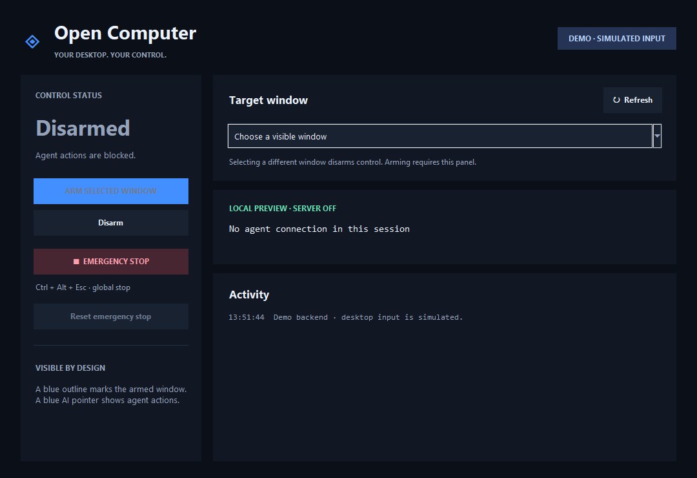
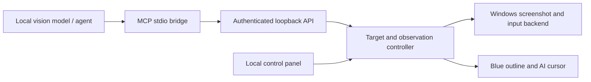

# Open Computer

[](https://github.com/jgouiza-debug/open-computer/actions/workflows/tests.yml)

[Download a Windows preview](https://github.com/jgouiza-debug/open-computer/releases) · [Ask a question or share feedback](https://github.com/jgouiza-debug/open-computer/discussions)

An independent, MIT-licensed Windows computer-use toolkit for local and
open-source AI models. A desktop panel lets you choose a window and arm control;
the model observes control text or screenshots and uses mouse and keyboard tools. A blue outline
and AI cursor make activity visible.

This is an early implementation, not a drop-in replacement for Codex's private
runtime. It follows the same **observe → one action → observe again** workflow.




## Install and run

### Portable Windows preview

On Windows 10 or newer (x64), download
[OpenComputer-0.1.5-windows-x64-portable.zip](https://github.com/jgouiza-debug/open-computer/releases/download/v0.1.5/OpenComputer-0.1.5-windows-x64-portable.zip),
extract the entire folder, and open **OpenComputer.exe**. Python, Tk, and Pillow
are bundled; you do not need to install Python or build Rust. Keep both EXEs and
`_internal` together. Models are supplied separately.

For compact control-text observations, start **Start-OpenComputer-Semantic.cmd**
to explicitly enable the included read-only Rust helper. Startup does not select
a target or arm control. Use **Copy MCP config** in the panel to connect a client.

See the [portable guide](docs/portable.md) and
[validation results](docs/portable-validation.json). The relocated-folder test
passed with Python absent from the child PATH, including Unicode export, MCP,
and hidden demo GUI initialization. A fresh Windows VM and a real model-driven
task were not tested for this archive. This is an unsigned preview.

### Python source installation

Requires Windows, Python 3.11+ with Tkinter, and Pillow >=12.2,<13 for
[single-window capture](https://pillow.readthedocs.io/en/stable/reference/ImageGrab.html).
Native fixture validation used Pillow 12.2.0; clean installation also passed
with Pillow 12.3.0. Pillow 13 is excluded pending validation.

Download and extract a source preview ZIP, then double-click **install.cmd**. After it
finishes, double-click **start-open-computer.cmd**. Python must already be
installed and available as `python`.

The same steps from PowerShell are:

```powershell
.\install.cmd
.\start-open-computer.cmd
```

The installer creates a project-local `.venv` in this folder, installs the package, and
writes two launchers. It does not start the app, arm control, or change a model
server. Double-click `start-open-computer.cmd` on later visits.

For a preview that simulates input, run `start-open-computer.cmd --demo`.
Ctrl+Alt+Esc is the emergency stop shortcut while the panel is running.

The local panel owns arming. Choose the intended window, arm it, and connect
your agent using the connection information in the panel. The API and MCP tools
cannot arm the computer. Disarm or Stop ends input authorization.

To upgrade, disarm and close the panel, update this source folder, and rerun the
installer. It updates the existing environment and regenerates the launchers.
Run this read-only check after starting the panel, keeping it disarmed:

```powershell
.\.venv\Scripts\python.exe -m opencomputer.setup doctor
```

Use `doctor --offline` to check dependencies without contacting a running panel.

For optional text/control observations, use an explicitly chosen Rust helper.
If the extracted Windows source ZIP includes `native/bin/opencomputer-native.exe`,
the installer also creates **start-open-computer-semantic.cmd**. Choose that
launcher to enable the helper; the normal launcher keeps image observations.
The helper starts only on the first semantic request. Selecting this launcher
does not arm input or start a model. Manual paths, runner modes, and validation
limits are described in [the semantic observation guide](docs/semantic.md).

## Components



- **Windows backend:** window discovery, screenshots, targeted mouse and keyboard
  operations through Win32.
- **Controller:** explicit target, local arming, fresh single-use observations,
  input validation, cancellation, and activity events.
- **Desktop panel:** target selection, status, activity feed, and stop controls.
- **Tool adapters:** authenticated localhost HTTP and an MCP stdio bridge.
- **Model adapter:** a bounded tool loop for an already-running OpenAI-compatible
  local vision model endpoint. No model downloads or model restarts.

Give your model the workflow in [docs/SKILL.md](docs/SKILL.md). Native coordinate
tools require a model that can interpret screenshots and call tools reliably.
The toolkit does not make a text-only model see.

## Connect an agent

Start the desktop panel and keep it disarmed. Click **Copy MCP config**, or
generate a configuration file using this installation's absolute paths:

```powershell
.\.venv\Scripts\python.exe -m opencomputer.setup config --output open-computer.mcp.json
```

Import the generated `open-computer` entry into your agent's MCP settings,
preserving any other servers already configured. Export refuses to overwrite an
existing file unless you add `--force`; omit `--output` to print JSON instead.
The generated configuration contains no service token. See the
[client setup guide](docs/clients.md) for Unsloth and LM Studio instructions.

Ask the agent to call `status` first. A successful response verifies the bridge
while the panel remains disarmed. Select a target window locally and request a
fresh observation; arm control when you are ready to permit input.

The bridge reads the local connection file at `~/.opencomputer/connection.json`.
Pass `--connection PATH` to use a different instance. Keep that file private;
it contains the service token. After restarting the panel, call `status` or
request a fresh observation before any state-changing tool. The bridge reloads
the connection file, but never replays an action across a changed connection.

Unsloth registration, skill loading, status, and a real text-only semantic
observation of nine Windows controls have been verified. Autonomous task
completion through Unsloth has not. Unsloth resizes images to a maximum edge of 1024 pixels while
the tool keeps the original dimensions. Follow the scaling instructions in
[docs/SKILL.md](docs/SKILL.md), or start with a target smaller than 1024 pixels on
each edge. Image observations need a vision-capable model with tool calling;
semantic observations can use a text model where the accessibility tree covers
the task.

For an already-running local vision model with OpenAI-compatible tool calling:

```powershell
.\.venv\Scripts\python.exe -m opencomputer.model_client "Describe the selected window" --model YOUR_MODEL --endpoint http://127.0.0.1:8080/v1 --max-steps 12
```

Replace the model name and endpoint with your server's actual configuration.
Select and arm the intended window locally before starting this runner, even
for a description task: the runner requires an armed session. For observations
while disarmed, use the MCP read-only tools directly.
The runner does not load models, start model servers, or arm control. Model and
server compatibility must be tested for the specific setup you choose.

## Speed and token efficiency

The example runner defaults to compact prompts, the latest screenshot, and a
short history of complete action/result pairs. Its model image is limited to
1280 pixels on the longest edge. Coordinates are converted back to native pixels
in code; the full-resolution image remains the source for action validation.
The native backend also reuses PNG encoding when a fresh capture has exactly the
same pixels. External MCP clients retain the native image/coordinate contract.

Use `--max-image-edge 0` for native resolution, or an explicit smaller budget for
a simple, readable interface. On a server supporting the compatible chat-template
extension, `--reasoning off` requests a direct response for that run only:

```powershell
.\.venv\Scripts\python.exe -m opencomputer.model_client "YOUR TASK" --model YOUR_MODEL --endpoint http://127.0.0.1:8080/v1 --max-image-edge 640 --reasoning off --metrics-json metrics.json
```

Reasoning defaults to `auto`, which sends no override. Other servers may reject
or ignore the extension. Metrics contain timings and server-reported token counts,
not prompts or screenshots. Missing usage stays unavailable instead of being
estimated from image size.

In a small local comparison, the explicit 640-pixel/no-reasoning configuration
used 30% fewer prompt tokens and averaged 42% lower response time. Unchanged-window
capture was about twice as fast in a separate native benchmark. These are scoped
measurements, not a general speed guarantee; resizing alone was slower in one
comparison. See [measurements, configuration, and limitations](docs/performance.md).

## Development

```powershell
.\.venv\Scripts\python.exe -m pip install ".[test]"
.\.venv\Scripts\python.exe -m unittest discover -s tests -v
```

### Optional Rust observation helper

The experimental Rust helper reads a selected window's pixels and bounded Windows
UI Automation control tree. It cannot press keys, click, or arm a session. The
regular Python controller remains the default; installing the Python package does
not build or enable this helper.

On Windows with Rust and the Visual Studio C++ build tools installed:

```powershell
cargo build --manifest-path native/Cargo.toml --locked --release -j 2
cargo test --manifest-path native/Cargo.toml --locked -j 2
```

Use `opencomputer.native_client.NativeClient` with the absolute path to
`native/target/release/opencomputer-native.exe`. Selected-window calls require both
the HWND and its expected process ID. See the [wire contract](docs/native-protocol.md)
for limits, password redaction, timeouts, and action-authority boundaries.

Compact control text is intended to reduce model input for ordinary Windows
controls. Canvas content and incomplete accessibility trees still need images.
The model runner can use it with `--observation-mode semantic` or `auto`;
image mode remains the default. One live read-only fixture comparison used 630
prompt tokens for control text versus 720 for the image, with all four answers
correct. See [the timing and cache limitations](docs/performance.md#measured-semantic-versus-image-input);
this is not a general Rust speedup or an autonomous input-task result.
The [owned-window validation results](docs/native-validation.md) record pixel
agreement, password redaction, and measured observation time.

Tests with fake backends do not move the real mouse. The separately invoked native
smoke test uses an isolated fixture window. A Windows run has verified screenshot
capture, a typed test phrase, and its button counter after the user focused that
fixture. The model runner also passed a live Windows fixture: an already-loaded
local vision model typed the exact phrase, clicked the test button once, and
observed the final counter of 1 across three real model responses. The fixture
independently checked its actual text and counter, then stopped and disarmed.
This proves that bounded task through the direct model runner; it does not imply
general desktop reliability or a complete task through Unsloth's chat UI.

[View the actual fixture result](docs/live-model-result.png).


```powershell
.\.venv\Scripts\python.exe scripts/native_smoke.py --run --wait-for-focus 60
```

Click the disposable test window when it appears. The test then types a known
phrase, clicks its button, verifies the results, and closes itself. Windows can
refuse background focus requests, so this explicit local focus step is needed
in some launch environments.

## Live model fixture

This separate opt-in test uses an already-running local vision/tool model. It
creates its own disposable window and temporary loopback service; it cannot use
an existing application's window or the main panel's connection file.

```powershell
.\.venv\Scripts\python.exe scripts/model_smoke.py --run --wait-for-focus 60 --endpoint http://127.0.0.1:8153/v1 --model YOUR_ALREADY_LOADED_MODEL --max-steps 8
```

The endpoint must explicitly report `loaded=true` at `/health` and idle slots at
`/slots`. These readiness routes are required by this test and are not provided
by every OpenAI-compatible server. It does not download, load, or restart models.
Click the fixture's empty entry field locally to authorize the test, then keep
the fixture focused. The model must type `Open Computer model test` and click
**Test click** once. It receives only the fixture's screenshots and narrowly
scoped tools. Closing the fixture or Ctrl+Alt+Esc cancels control.

Each run saves its receipt, actual model responses, exact model-visible PNGs,
observation PNGs with timestamps and hashes, and a final native capture under a
unique `artifacts/model-smoke/` subdirectory. Artifacts are private and excluded
from Git. Input events report attempts; the recorded field text and button
counter independently establish their effects. `passed=true` requires the full
task and safety checks, so partial typing, a claimed success, or a rejected stale
action does not constitute a pass. These results establish only that particular
fixture/model run, not arbitrary desktop reliability.

## Current boundaries

Windows only. Coordinates refer to the captured client area of the selected
window. Screenshot-based coordinate control comes first; accessibility
trees, DOM browser tools, occluded-window capture, and other operating systems
are future work. Windows input is shared with the user and is not an atomic
per-window transaction. Foreground, geometry, and occlusion checks reduce risk,
but do not establish a security sandbox. Use a separate desktop/VM for untrusted
agents, and avoid interacting with the target during an automated action.

The bearer token grants access to screen content and permitted tools; keep it
private. The service binds to loopback and rejects browser-origin requests.
Screenshots may contain private information: the agent and model endpoint you
choose receive those images.

See [CONTRIBUTING.md](CONTRIBUTING.md) for development and
[SECURITY.md](SECURITY.md) for private vulnerability reporting.

## License

[MIT](LICENSE). Built independently; no proprietary Codex runtime is included.
